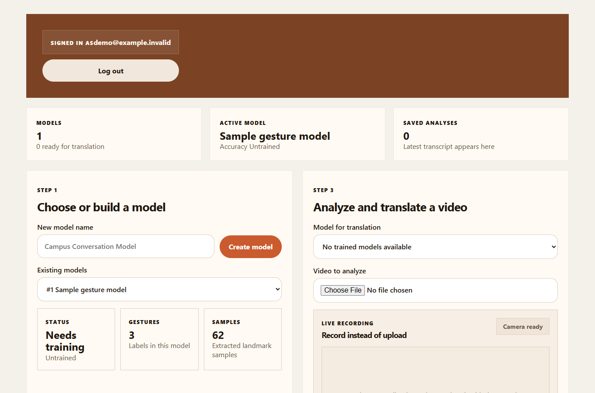

# CPSC 304 Gesture Recognition

Our UBC database course team built a web app for recognizing hand gestures from video and webcam frames. Users can create a gesture dataset, upload labeled examples, train a model, and review saved video analyses and transcripts. The model recognizes the labels it was trained on.

The app uses a [React frontend](frontend/src), a [FastAPI backend](backend), and an [Oracle database schema](backend/sql/demotable_schema.sql). The backend extracts hand landmarks with MediaPipe and uses them to train and run gesture models.

*The screenshot shows the app with synthetic data.*

## My contributions

I’m Justin Hoang (@Kiekeku). I worked on the gesture interface and helped connect it to the backend and database.

- I built the initial [gesture model studio](frontend/src/features/GestureModelStudio.jsx) for managing models, gesture labels, and training videos. I also added [webcam recognition controls](frontend/src/App.jsx) to the main workspace.
- I pair-programmed on our [OpenCV video-processing pipeline](backend/services/sign_language), which samples video frames and prepares them for hand-landmark extraction.
- I consolidated our [Oracle SQL examples](backend/sql/combined_sql.sql) and added [editable query endpoints](backend/routers/demotable_router.py) for exploring the project’s data.
- I restored the registration form and fixed how [frontend API requests](frontend/src/api/http.js) carry the signed-in user ID.

## Setup

Running the full app requires access to the UBC course Oracle database. The FastAPI service serves the checked-in React build from `frontend/dist`.

1. Copy [`backend/.env.example`](backend/.env.example) to `.env` in the repository root. Set your Oracle connection details and choose an available application port. Keep your local `.env` out of Git.
2. If you’re developing off campus, use the [Bash](scripts/mac/db-tunnel.sh) or [Windows](scripts/win/db-tunnel.cmd) tunnel script. The script updates the Oracle host and port in `.env` to match the local tunnel.
3. On a Bash host with Python and its `venv` module, run [`bash scripts/deploy.sh`](scripts/deploy.sh) from the repository root. It installs the [backend dependencies](backend/requirements.txt) into a virtual environment and starts FastAPI. Open the server’s hostname and the port configured in `.env`.

To rebuild the frontend after changing its source, install Node.js and npm and run [`bash scripts/build-frontend.sh`](scripts/build-frontend.sh).
